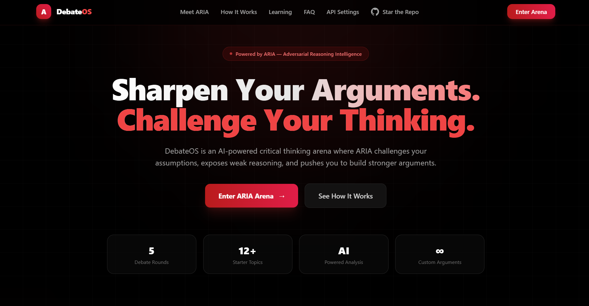
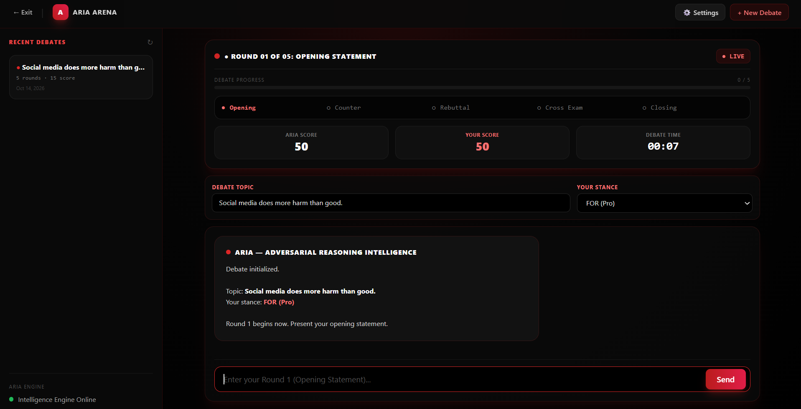

<div align="center">



<br>

# DEBATEOS

### ARIA ARENA | AI-POWERED ADVERSARIAL REASONING

**Challenge Your Assumptions. Strengthen Your Arguments. Master Critical Thinking.**

An AI-driven debate platform designed to sharpen reasoning, expose logical fallacies, challenge perspectives, and evaluate arguments through structured adversarial conversations.

<br>

[](https://www.python.org/)
[](https://flask.palletsprojects.com/)
[](https://ai.google.dev/)
[](https://tailwindcss.com/)
[](LICENSE)

<br>

**Built with Python, Flask, SQLite, and Google Gemini AI**

</div>

---

## Project Overview

**DebateOS** is an AI-powered critical thinking and adversarial debate platform built to help users develop stronger arguments, evaluate opposing viewpoints, and improve logical reasoning.

Powered by **ARIA (Adversarial Reasoning Intelligence)** and integrated with Google's Gemini API, the platform acts as an intelligent debate opponent that challenges assumptions, identifies weaknesses in arguments, evaluates supporting evidence, and provides structured feedback.

The application follows a five-round debate format, guiding users through opening statements, evidence evaluation, challenges, counterarguments, and a final verdict. Each stage encourages analytical thinking and provides opportunities to refine reasoning.

With its cyber-black and crimson interface, persistent debate history, performance scorecards, and configurable AI integration, DebateOS transforms traditional argument practice into an interactive, AI-driven experience.

<div align="center">



**The ARIA Arena — Your Personal AI-Powered Debate Environment**

</div>

---

## Core Features

### 1. ARIA Adversarial AI Engine

* Powered by Google's Gemini 2.5 Flash model.
* Configured with structured system instructions for adversarial reasoning.
* Challenges user assumptions and examines the strength of arguments.
* Generates persuasive counterarguments and alternative perspectives.
* Encourages evidence-based reasoning rather than unsupported claims.

### 2. Structured Five-Round Debate System

The platform organizes debates into five distinct stages:

| Round | Stage             | Purpose                                                                 |
| ----- | ----------------- | ----------------------------------------------------------------------- |
| 01    | Opening Statement | Present the central argument and establish the position.                |
| 02    | Evidence          | Support claims with evidence, examples, and logical justification.      |
| 03    | Challenge         | Identify weaknesses, question assumptions, and examine inconsistencies. |
| 04    | Counter           | Respond to objections and strengthen the original argument.             |
| 05    | Verdict           | Review the debate and evaluate the overall quality of reasoning.        |

### 3. Real-Time Adversarial Analysis

* Evaluates the quality and consistency of arguments.
* Identifies hidden assumptions and logical gaps.
* Highlights potential reasoning errors and weaknesses.
* Generates structured feedback and argument assessments.
* Provides scoring metrics to help users understand their performance.

### 4. Persistent Debate History

* Uses SQLite to store debate sessions.
* Integrates Flask-SQLAlchemy for database operations.
* Maintains debate records for later review.
* Enables users to revisit previous discussions and evaluate their progress.

### 5. Premium Cyber-Black and Crimson Interface

* Dark, modern interface with a distinctive crimson visual identity.
* Tailwind CSS styling with glassmorphism-inspired components.
* Dynamic debate scorecards and performance indicators.
* Live debate timers and structured round progression.
* Custom SVG branding and polished dashboard elements.
* Responsive interface designed for an engaging debate experience.

### 6. Configurable Gemini API Integration

* Provides an API key configuration interface.
* Supports connection verification before starting a debate.
* Uses browser local storage to retain the configured API key.
* Allows users to configure their own Gemini API credentials.

**Security note:** Browser local storage is not encrypted secure storage. Avoid using shared or untrusted devices, and never expose API keys in public repositories, screenshots, or client-side logs. For production deployments, a server-side secret-management approach is preferable.

### 7. Deployment-Ready Architecture

* Flask-based Python backend.
* Organized application structure suitable for further development.
* Includes a Vercel configuration file for deployment experimentation.
* Can be extended with additional AI models, debate formats, and analytical capabilities.

---

## Technology Stack

| Category                 | Technologies                      |
| ------------------------ | --------------------------------- |
| Programming Language     | Python                            |
| Backend Framework        | Flask 3.1.0                       |
| AI Integration           | Google GenAI SDK (`google-genai`) |
| AI Model                 | Gemini 2.5 Flash                  |
| Data Validation          | Pydantic                          |
| Database                 | SQLite                            |
| ORM                      | Flask-SQLAlchemy                  |
| Frontend                 | HTML5, CSS, JavaScript            |
| UI Framework             | Tailwind CSS 3.x                  |
| Branding                 | Custom SVG                        |
| Deployment Configuration | Vercel                            |

---

## Application Architecture

DebateOS combines a web application backend, an AI reasoning engine, a persistent database, and an interactive frontend.

```text
                    DEBATEOS — ARIA ARENA
                             |
              +--------------+--------------+
              |                             |
        Frontend Interface            Flask Backend
       HTML / CSS / JavaScript               |
              |                   +----------+----------+
              |                   |                     |
       Debate Interaction    ARIA AI Engine       SQLite Database
                                  |                     |
                           Google Gemini API      Debate History
                                  |
                         Adversarial Analysis
                                  |
                    Argument Evaluation and Verdict
```

The frontend manages user interactions and debate progression. The Flask backend coordinates application functionality, the ARIA engine generates AI responses, and SQLite provides persistent storage for supported database operations.

---

## Installation and Quick Start

Follow these steps to run DebateOS on your local machine.

### Prerequisites

Ensure the following tools are installed:

* Python 3.10 or later, compatible with the project's dependencies.
* Git.
* A modern web browser.
* A Google Gemini API key.

### Step 1: Clone the Repository

```bash
git clone https://github.com/MobeenFatimaa/DebateOS.git
cd DebateOS
```

### Step 2: Create a Virtual Environment

```bash
python -m venv .venv
```

Activate the environment on Windows PowerShell:

```powershell
.\.venv\Scripts\Activate.ps1
```

If activation is restricted by your PowerShell execution policy, consult the official Python documentation or use Command Prompt to activate the environment.

### Step 3: Install Dependencies

Install the project's required Python packages:

```bash
python -m pip install -r requirements.txt
```

### Step 4: Run the Application

Start the Flask application:

```bash
python app.py
```

### Step 5: Open DebateOS

Open your browser and navigate to:

```text
http://127.0.0.1:5000
```

Configure your Gemini API key using the application's API configuration interface, verify the connection, and enter the ARIA Arena to begin a debate.

**Note:** The exact startup command and environment requirements depend on the current repository structure and configuration.

---

## Google Gemini API Configuration

DebateOS uses Google's Gemini API to power the ARIA adversarial reasoning engine.

To configure the integration:

1. Obtain an API key through Google AI Studio.
2. Launch the DebateOS application.
3. Open the API configuration interface.
4. Enter your API key.
5. Verify the connection.
6. Start a debate after successful configuration.

Official resource: [Google AI Studio](https://aistudio.google.com/)

**Important:** If the application sends requests directly from browser JavaScript, the API key may be accessible to users inspecting the browser. For production use, route AI requests through the Flask backend and store credentials in environment variables or a suitable secrets manager.

---

## Deployment on Vercel

The repository includes a `vercel.json` configuration file intended to support Vercel deployment.

To explore deployment:

1. Push the project to GitHub.
2. Import the repository into your Vercel account.
3. Configure the appropriate Python runtime and application entry point.
4. Configure required environment variables and API credentials.
5. Deploy the application.
6. Test AI connectivity, database behavior, and all application routes.

**Deployment considerations:**

* Verify that the Vercel configuration matches the current Flask application structure.
* Serverless deployments generally do not provide durable local filesystem storage. SQLite database changes may not persist reliably across deployments or function invocations.
* Browser local storage is separate from server-side environment configuration.
* Confirm that all required dependencies and runtime settings are compatible with the deployment environment.

For reliable production persistence, consider a managed database if the application outgrows local SQLite storage.

Official deployment resource: [Vercel Documentation](https://vercel.com/docs)

---

## Potential Applications

DebateOS can support a range of educational and analytical activities, including:

* Critical thinking practice.
* Argument construction and evaluation.
* Academic debate preparation.
* Evidence-based reasoning exercises.
* Examination of opposing viewpoints.
* Logical fallacy awareness.
* Public speaking preparation.
* Structured discussion and decision-making practice.

The platform is intended as a reasoning and learning tool. Its AI-generated assessments should be treated as guidance rather than definitive judgments of correctness.

---

## Future Development Opportunities

Potential enhancements include:

* Additional debate modes and configurable difficulty levels.
* More detailed argument-quality analytics.
* Debate summaries and downloadable reports.
* Topic recommendations and custom debate prompts.
* Improved historical performance tracking.
* Additional AI model integrations.
* Enhanced security and server-side API key management.
* Persistent cloud database support.
* More comprehensive evaluation of evidence quality and logical fallacies.

---

## License

This project is distributed under the **MIT License**. See the [`LICENSE`](LICENSE) file for the complete license terms.

---

## Author

<div align="center">

### Mobeen Fatima

**AI and Machine Learning | Data Science | Software Development**

Building AI-powered applications that combine intelligent reasoning, practical problem-solving, and thoughtful user experiences.

[GitHub](https://github.com/MobeenFatimaa)

</div>

---

<div align="center">

**DEBATEOS — ARIA ARENA**

*Think critically. Argue logically. Challenge intelligently.*

</div>
